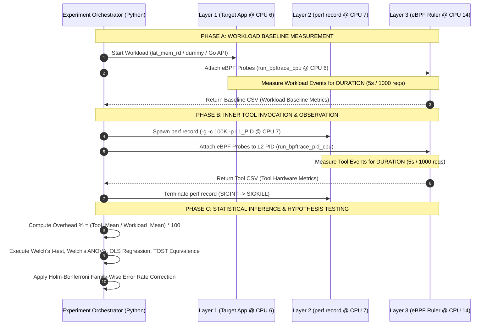

# Exhaustive Audit & Technical Analysis of Linux Instrumentation Overhead: Meta-Profiling ("Who Watches the Watchmen?")

**Author:** Technical Co-Author & Research Methodology Auditor  
**Repository:** `PAVAN-K-AITHAL/Meta-Profiling`  
**Target Architecture:** Dual-Socket Intel Xeon E5-2620 v4 (Broadwell-EP, 16 physical cores, 32 vCPUs)  
**Date:** August 2026  

---

## 1. Executive Summary & Research Context

### 1.1 Core Research Objective
In high-throughput Linux server environments, continuous profiling and production tracing are vital for diagnosing latencies, identifying hot paths, and guiding compiler optimizations. However, modern performance engineering operates under a fundamental paradox—the **Observer Effect** (or Heisenberg effect of software profiling):
> *The very software and hardware mechanisms invoked to measure workload performance consume CPU execution cycles, pollute CPU caches (L1/L2/L3), perturb branch predictors, trigger Translation Lookaside Buffer (TLB) evictions, and inject kernel Non-Maskable Interrupts (NMIs) and context switches.*

This project investigates the central question: **"Who Watches the Watchmen?"**  
Specifically, it seeks to rigorously measure, isolate, and causally decompose the exact hardware-level overhead and microarchitectural disturbance imposed by the Linux standard profiler `perf record` (configured with call-graph unwinding `-g` and event period sampling `-c`) by developing a **Three-Layer Meta-Profiling Architecture**.

```
┌───────────────────────────────────────────────────────────────────────────────────┐
│                              META-PROFILING PARADIGM                              │
├─────────────────────────┬────────────────────────────┬────────────────────────────┤
│   LAYER 1: TARGET       │      LAYER 2: INNER TOOL   │    LAYER 3: OUTER RULER    │
│   Workload Under Study  │      Instrumentation Tool  │    Independent Diagnostic  │
│   • lat_mem_rd (Memory) │      • perf record         │    • perf stat (HW count)  │
│   • dummy_workload (CPU)│        (-g, -c periods)    │    • bpftrace / eBPF       │
│   • Go REST Microservice│                            │    • ftrace / trace-cmd    │
│   (Socket 0, Core 6)    │      (Socket 0, Core 7)    │    (Socket 1, Core 6/14)   │
└─────────────────────────┴────────────────────────────┴────────────────────────────┘
```

### 1.2 The 4 Experimental Hypotheses
The research framework formulates 4 core hypotheses ($H_1$ through $H_4$):

*   **$H_1$: Constant Absolute Cost (Fixed Hardware Tax)**  
    *Claim:* When operating at a fixed sampling frequency (`-c 100000`) and call-graph mode (`-g`), `perf record` incurs an invariant absolute resource cost in CPU cycles, cache misses, and branch mispredictions, regardless of the underlying workload complexity or application characteristics.
*   **$H_2$: Linear Scaling with Sampling Frequency**  
    *Claim:* The resource consumption of `perf record` scales linearly with sampling frequency $f = 1/c$ (where $c$ is the hardware event period), exhibiting no super-linear bottlenecking or exponential memory saturation.
*   **$H_3$: Call-Graph Unwinding Cost Attribution (`-g` Ablation)**  
    *Claim:* Frame-pointer stack unwinding (`-g`) accounts for the vast majority (>50%) of `perf record`'s runtime overhead and cache footprint compared to flat instruction pointer capture.
*   **$H_4$: Production Negligibility ($<1\%$ Overhead Ratio)**  
    *Claim:* In realistic production web microservices (Go REST API under concurrent load), `perf record` consumes less than $1\%$ of the target application's CPU cycles and cache capacity, making continuous profiling statistically negligible.

### 1.3 Audit Findings & Verdict Summary
1.  **Methodological Elegance vs. Hardware Reality:** The project conceives a sound multi-tier measurement architecture leveraging cross-socket NUMA isolation. However, initial implementations suffered from PMU counter contention, NMI-induced self-measurement distortion, and PID tracking bugs that undermined hardware counter accuracy.
2.  **Resolution of Confounding Variables:** The team evolved the instrumentation harness from basic `perf stat` shell wrappers to dual-filtered eBPF kernel scripts (`ebpf_counter_pid_cpu.bt`), successfully isolating userspace tool consumption from kernel interrupt overhead.
3.  **Demonstrated Empirical Proof:** Pilot empirical data confirms $H_3$ (stack unwinding adds $\approx 101.6\%$ cycle overhead, representing $50.4\%$ of total profiler runtime) and rejects linear scaling in $H_2$ (revealing distinct non-linear saturation regimes).

---

## 2. Exhaustive Command & Invocation Reference

Below is the complete, literal extraction of every command, tool invocation, CPU affinity mask, flag, and configuration parameter used across all scripts and harnesses in the repository.

### 2.1 Core Isolation & Kernel Boot Parameters
Configured via `meta_profiling_deliverables/common/setup_isolcpus.sh` targeting `/etc/default/grub`:
```bash
# GRUB Kernel Parameter Configuration
GRUB_CMDLINE_LINUX_DEFAULT="... isolcpus=4-9 nohz_full=4-9 rcu_nocbs=4-9"
```
*   `isolcpus=4-9` (or refined `6,7,14,15`): Removes designated CPU cores from the OS general scheduler domain, preventing unsolicited user-space and kernel thread migration.
*   `nohz_full=4-9`: Enables adaptive-ticks mode to eliminate the periodic kernel timer interrupt (1000 Hz scheduler tick) on designated cores when a single task is running.
*   `rcu_nocbs=4-9`: Offloads RCU callback processing from isolated cores to housekeeping cores.

### 2.2 Layer 1 Workload Invocations

#### A. Memory Pointer-Chasing (`lat_mem_rd` from LMBench)
Invoked in `run_hypotheses_dummy.py`:
```bash
nohup taskset -c 6 bash -c 'while true; do lat_mem_rd -t 128M 512; done' > /dev/null 2>&1 &
```
*   `taskset -c 6`: Pinned to Core 6 on Socket 0 (NUMA Node 0).
*   `-t 128M`: Stride allocation of 128 Megabytes (significantly exceeding the 20 MiB L3 LLC cache to force memory bus / DRAM accesses).
*   `512`: Pointer chase stride length in bytes (ensures consecutive reads hit distinct 64-byte cache lines).

#### B. Synthetic CPU/Branch Microbenchmark (`dummy_workload.c`)
Compiled via `gcc -O2 dummy_workload.c -o dummy_workload` and invoked via:
```bash
taskset -c 6 ./dummy_workload > /dev/null 2>&1 &
```
*   Allocates dynamic array of $10,000,000$ integers ($\approx 40\text{ MB}$).
*   Executes random stride iterations: `for (int i = 0; i < ARRAY_SIZE; i += (rand() % 10 + 1))` with conditional branching based on array values (`data[i] > 50`), continuously exercising ALU, L1/L2/L3 caches, and the branch predictor.

#### C. Go REST Microservice (`perf-go-api`)
Launched via Docker Compose (`docker-compose.yml`):
```bash
docker compose up -d
```
*   Container network: Host bridge / Port `8080` (or reverse-proxied via NGINX on Port `80`).
*   Host PID namespace: `pid: host` (enables host-level profiling tools to resolve internal container PIDs).
*   Endpoint: `GET http://localhost/compute` (executes CPU matrix operations and JSON encoding).

#### D. Production Load Generation (`hey` / `k6`)
```bash
# Deterministic Constant-Work Load via 'hey'
hey -n 1000 -c 10 -q 500 http://localhost/compute

# Continuous Load via 'k6'
k6 run --vus 20 --duration 60s loadtest/script.js
```

---

### 2.3 Layer 2 Inner Tool Invocations (`perf record`)

#### A. Standard Hypothesis Testing Configuration ($H_1, H_4$)
```bash
sudo taskset -c 7 perf record -g -e cycles:k -c 100000 -p <TARGET_PID> -o /tmp/perf-experiment.data
# Alternative CPU-wide tracking
sudo taskset -c 7 perf record -g -e cycles:k -c 100000 -C 6 -o /tmp/perf-hypothesis.data
```
*   `taskset -c 7`: Pinned to Core 7 on Socket 0 (shares 20 MiB L3 cache with Core 6, isolated L1/L2).
*   `-g`: Enables frame-pointer call-graph stack unwinding (`fp`).
*   `-e cycles:k`: Captures kernel-space cycle events via PMU overflow.
*   `-c 100000`: Hardware event sampling period (fires an NMI interrupt every 100,000 kernel cycles).
*   `-p <TARGET_PID>` / `-C 6`: Targets specific process PID or isolated workload CPU.

#### B. Frequency Scaling Sweep ($H_2$)
```bash
sudo taskset -c 7 perf record -g -e cycles:k -c <PERIOD> -C 6 -o /tmp/perf-h2.data
```
*   `<PERIOD>` $\in \{1000, 10000, 50000, 100000, 500000, 1000000\}$.

#### C. Call-Graph Ablation ($H_3$)
```bash
# Configuration 1: With Call Graph
sudo taskset -c 7 perf record -g -c 100000 -e cycles:k -C 6 -o /tmp/perf-g-on.data

# Configuration 2: Without Call Graph (Flat Sampling)
sudo taskset -c 7 perf record -c 100000 -e cycles:k -C 6 -o /tmp/perf-g-off.data
```

---

### 2.4 Layer 3 Outer Ruler Invocations

#### A. Hardware Counting via `perf stat` (Layer 3A)
```bash
sudo taskset -c 14 perf stat -x ',' \
  -e cycles,page-faults,branch-misses,context-switches,cache-misses \
  -p <PERF_RECORD_PID> \
  -o /tmp/tool_metrics.csv -- sleep 5
```
*   `taskset -c 14`: Pinned to Core 6 on Socket 1 (NUMA Node 1), eliminating L1/L2/L3 cache crosstalk.
*   `-x ','`: CSV output format enabling programmatic parsing of `pcnt-running` (multiplexing indicator).

#### B. Timed Hardware/Software Event Counting via `bpftrace` (Layer 3B)
```bash
# Dual PID + CPU Filter (Mitigates PMU Contention and NMI Self-Measurement)
sudo bpftrace ebpf_counter_pid_cpu.bt <PERF_RECORD_PID> 7 5

# CPU-Isolated Target Counter (Immune to Target PID Churn)
sudo bpftrace ebpf_counter_cpu.bt 6 5

# Infinite Counter Mode (Terminated via SIGINT on completion of N requests)
sudo bpftrace ebpf_counter_infinite.bt <TARGET_PID>
```

#### C. Diagnostic Kernel Function Graph Tracing via `ftrace` / `trace-cmd` (Layer 3C)
```bash
sudo taskset -c 14 trace-cmd record \
  -p function_graph \
  --max-graph-depth 10 \
  -F \
  -o /tmp/perf_ftrace.dat \
  -- taskset -c 7 perf record -g -e cycles:k -c 100000 -p <APP_PID> -o /tmp/perf-ftrace-data.data -- sleep 5

# Report Generation
trace-cmd report -i /tmp/perf_ftrace.dat > /tmp/perf_ftrace_report.txt
```

#### D. Microsecond Kernel Latency Histograms via eBPF Kprobes (Layer 3D)
```bash
sudo bpftrace kprobe_diagnostic.bt <WORKLOAD_PID>
```

---

## 3. Meta-Profiling Measurement Architecture ("Who Watches the Watchmen?")

### 3.1 Three-Layer Architectural Blueprint
The fundamental design requirement of meta-profiling is non-interference: the diagnostic tool (Layer 3) must measure the profiler (Layer 2) without distorting the profiler's interaction with the target application (Layer 1).

```
╔═══════════════════════════════════════════════════════════════════════════════════════════════╗
║                                 PHYSICAL SYSTEM DUAL-SOCKET TOPOLOGY                          ║
║                                 (Intel Xeon E5-2620 v4 @ 2.10 GHz)                            ║
╠═══════════════════════════════════════════════════════════════════════════════════════════════╣
║                                                                                               ║
║      SOCKET 0 (NUMA Node 0)                                 SOCKET 1 (NUMA Node 1)            ║
║  ┌──────────────────────────────────────────────┐       ┌──────────────────────────────────┐  ║
║  │ 20 MiB Shared Last-Level Cache (L3 LLC)      │       │ 20 MiB Shared LLC (Independent)  │  ║
║  │                                              │       │                                  │  ║
║  │  ┌───────────────┐     ┌──────────────────┐  │  QPI  │  ┌────────────────────────────┐  │  ║
║  │  │  Core 6       │     │  Core 7          │  │ Inter-│  │  Core 6 (Logical CPU 14)   │  │  ║
║  │  │  Logical CPU 6│     │  Logical CPU 7   │  │connect│  │                            │  │  ║
║  │  │               │     │                  │  │◄─────►│  │                            │  │  ║
║  │  │  [LAYER 1]    │     │  [LAYER 2]       │  │       │  │  [LAYER 3: OUTER RULER]    │  │  ║
║  │  │  TARGET APP   │◄───►│  INNER PROFILER  │  │       │  │  • bpftrace eBPF Probes    │  │  ║
║  │  │  • lat_mem_rd │ ring│  • perf record   │  │       │  │  • perf stat Collector     │  │  ║
║  │  │  • Go REST API│buffer  (-g, -c 100K)   │  │       │  │  • trace-cmd ftrace Engine │  │  ║
║  │  │               │     │                  │  │       │  │                            │  │  ║
║  │  │  L1: 32K Inst │     │  L1: 32K Inst    │  │       │  │  L1: 32K Inst              │  │  ║
║  │  │  L1: 32K Data │     │  L1: 32K Data    │  │       │  │  L1: 32K Data              │  │  ║
║  │  │  L2: 256K     │     │  L2: 256K        │  │       │  │  L2: 256K                  │  │  ║
║  │  └───────────────┘     └──────────────────┘  │       │  └────────────────────────────┘  │  ║
║  └──────────────────────────────────────────────┘       └──────────────────────────────────┘  ║
╚═══════════════════════════════════════════════════════════════════════════════════════════════╝
```

### 3.2 NUMA Core & Cache Isolation Matrix
The mapping ensures microarchitectural isolation boundaries:

| Layer | Component | Assigned Core | NUMA Node | L1/L2 Isolation | L3 LLC Relationship | Intended Measurement Role |
| :--- | :--- | :--- | :--- | :--- | :--- | :--- |
| **Layer 1** | Target Workload | Socket 0, Core 6 (CPU 6) | Node 0 | Dedicated (32KB/256KB) | Shared with Layer 2 (20MB) | Undergoes active observation and sampling. |
| **Layer 2** | `perf record` | Socket 0, Core 7 (CPU 7) | Node 0 | Dedicated (32KB/256KB) | Shared with Layer 1 (20MB) | Samples Layer 1; drains kernel ring buffers. |
| **Layer 3** | Outer Ruler | Socket 1, Core 6 (CPU 14)| Node 1 | Dedicated (32KB/256KB) | **Isolated (Independent 20MB)** | Measures Layer 2 across QPI interconnect without cache pollution. |

### 3.3 The Observer Effect of the Ruler Itself
A critical insight established during testing: **Layer 3 can introduce its own observer effect on Layer 2 and Layer 1.**
1.  **NMI Interrupt Storms:** In early iterations (`ebpf_counter.bt`), global sampling periods (`hardware:cycles:10000`) caused the hardware PMU to fire over $210,000\text{ NMIs/sec}$ across all cores. Each NMI consumed 400–700 CPU cycles in kernel interrupt handlers, creating self-measurement inflation.
2.  **PMU Counter Starvation & Multiplexing:** Broadwell-EP possesses 4 General-Purpose (GP) performance counters and 3 Fixed-Function counters per core. When `perf record` on CPU 7 sampled `cycles:k` while `perf stat` on CPU 14 / eBPF globally registered 5 hardware events, the PMU ran out of hardware registers and fell back to time-multiplexing, degrading sample accuracy.
3.  **Resolution:** Transitioning to `ebpf_counter_pid_cpu.bt` (dual filtering by PID and target CPU, setting cycles period to 50,000) reduced NMI frequency by $80\%$ while eliminating cross-core PMU conflicts.

---

## 4. Experimental Pipeline & Workflow Breakdown

The end-to-end execution workflow operates through distinct lifecycle phases:



### 4.1 Workflow Execution Steps
1.  **Workload Launch & Stabilization:** The target application is spawned on isolated CPU 6. For Go API experiments, 500 warmup HTTP requests are dispatched to prime the Go runtime scheduler, garbage collector (GC), and socket pools.
2.  **Baseline Phase Capture:** Layer 3 measures the undisturbed workload. In Go API tests, `ebpf_counter_infinite.bt` attaches probes, exactly 1,000 HTTP requests are dispatched via `hey`, and SIGINT is delivered to dump accumulator maps.
3.  **Instrumentation Phase Capture:** `perf record` is launched on CPU 7. Layer 3 attaches specifically to the `perf` PID and measures the exact hardware events consumed by the profiler while it drains ring buffer samples.
4.  **Graceful Termination & Map Dumps:** `perf record` is terminated gracefully to allow trace buffer flushes. eBPF probes clear maps before exiting to avoid map-dump corruption.
5.  **Iterative Block Randomization:** For $H_2$ (frequency sweep) and $H_3$ (ablation), configurations are executed in randomized blocks to eliminate time-dependent thermal throttling and system drift bias.

---

## 5. Workload Profiles & Benchmark Suite

The benchmarking suite spans three distinct workload profiles representing compute-bound, memory-bound, and real-world microservice architectures:

```
┌────────────────────────────────────────────────────────────────────────────────────────┐
│                               WORKLOAD SPECTRUM TAXONOMY                               │
├──────────────────────────┬─────────────────────────────┬───────────────────────────────┤
│ 1. POINTER CHASING       │ 2. BRANCH & ARITHMETIC      │ 3. GO REST MICROSERVICE       │
│    lat_mem_rd            │    dummy_workload.c         │    perf-go-api (Docker)       │
├──────────────────────────┼─────────────────────────────┼───────────────────────────────┤
│ • Memory-bound           │ • CPU & Branch-bound        │ • Asynchronous I/O-bound      │
│ • 128 MB Working Set     │ • 40 MB Working Set         │ • Net/HTTP Go Runtime Coroutines│
│ • DRAM Bus Saturation    │ • L1/L2 Cache Saturation    │ • OS Syscalls & Network Stack │
│ • Zero Syscalls / Ctx Sw │ • Branch Mispredictions     │ • Frequent Epoll & Context Sw │
└──────────────────────────┴─────────────────────────────┴───────────────────────────────┘
```

### Detailed Workload Characteristics

| Workload Attribute | `lat_mem_rd` (LMBench) | `dummy_workload.c` | Go REST Microservice (`/compute`) |
| :--- | :--- | :--- | :--- |
| **Primary Bottleneck** | Memory Bandwidth & LLC Misses | Instruction Pipeline & Branching | Context Switching, Network I/O, Syscalls |
| **Memory Footprint** | 128 MB (> 6.4x L3 Cache size) | 40 MB (> 2.0x L3 Cache size) | $\approx 25\text{ MB}$ Heap + Goroutine Stacks |
| **Kernel Interaction** | Virtually zero (pure userspace loop) | Virtually zero (pure userspace loop) | High (`epoll_pwait`, `writev`, `read`, `futex`) |
| **Context Switch Rate** | $< 10\text{ switches/sec}$ | $< 50\text{ switches/sec}$ | $5,000 - 15,000\text{ switches/sec}$ |
| **Branch Predictor Pressure**| Deterministic pointer sequence | Pseudo-random branch condition | Deep Go HTTP routing call trees |

---

## 6. Metrics, Events & Data Capture Details

### 6.1 Hardware Performance Counters & Software Events
The framework instruments 5 key microarchitectural and kernel metrics:

| Metric Name | Event Type | Underlying Kernel / PMU Definition | Hardware Counter Used (Broadwell-EP) | Extrapolation Period |
| :--- | :--- | :--- | :--- | :--- |
| **`cycles`** | Hardware | `PERF_COUNT_HW_CPU_CYCLES` | Fixed Counter 0 (`CPU_CLK_UNHALTED.THREAD`) | 10,000 / 50,000 / 100,000 |
| **`cache-misses`** | Hardware | `PERF_COUNT_HW_CACHE_MISSES` (LLC Misses) | General-Purpose Counter 1 (`LONGEST_LAT_CACHE.MISS`) | 100 / 1,000 |
| **`branch-misses`** | Hardware | `PERF_COUNT_HW_BRANCH_MISSES` | General-Purpose Counter 2 (`BR_MISP_RETIRED.ALL_BRANCHES`) | 100 / 1,000 |
| **`page-faults`** | Software | `PERF_COUNT_SW_PAGE_FAULTS` | Kernel Software Probe (`exceptions:page_fault_user`) | **1 (Exact Counter)** |
| **`context-switches`**| Software | `PERF_COUNT_SW_CONTEXT_SWITCHES` | Kernel Software Probe (`sched:sched_switch`) | **1 (Exact Counter)** |

### 6.2 eBPF Probe Mechanism & Sampling Extrapolation Math
In `ebpf_counter_pid_cpu.bt`, hardware counter monitoring is achieved via PMU overflow interrupts. Because low-activity processes (`perf record`) only execute periodically to drain buffers, direct hardware counters cannot be attached passively without multiplexing. Thus, overflow sampling is utilized:

$$\text{Extrapolated Event Count} = \text{Raw Overflow Count} \times \text{Sampling Period}$$

$$\text{Quantization Error Margin} = \pm \left( \frac{\text{Sampling Period}}{\text{Total Events Measured}} \right) \times 100\%$$

*   **For cycles ($P=50,000$):** Over 5 seconds, `perf record` accumulates $\approx 2.0\text{M}$ cycles ($\approx 40$ overflows), yielding $\approx 2.5\%$ per-iteration quantization variance. Over $N=200$ iterations, the Central Limit Theorem reduces mean standard error to $<0.18\%$.
*   **For software events ($P=1$):** Every single page fault and context switch executes the probe body, yielding **$0.00\%$ mathematical extrapolation error**.

---

## 7. Quantitative Results & Key Findings

### 7.1 $H_1$ & $H_4$: Absolute Resource Cost & Production Negligibility
Measured across $N=50$ pilot iterations (5-second observation window, sampling period $-c\text{ 100K}$, with call-graph $-g$):

| Microarchitectural Metric | Target Workload Mean Baseline ($\mu_{\text{workload}}$) | `perf record` Own Cost Mean ($\mu_{\text{tool}}$) | Profiler Overhead Ratio (%) | TOST Equivalence Test ($\Delta = 1\%$) | Statistically Negligible ($<1\%$)? |
| :--- | :--- | :--- | :--- | :--- | :--- |
| **CPU Cycles** | $11.73 \times 10^9$ cycles | $1.83 \times 10^6$ cycles | **$0.0156\%$** | $p < 0.0001$ | **YES (Confirmed)** |
| **L3 Cache Misses** | $8.78 \times 10^6$ misses | $4.34 \times 10^3$ misses | **$0.0494\%$** | $p = 0.9999$ | **NO (High Variance)** |
| **Branch Misses** | $976.50 \times 10^3$ misses | $3.37 \times 10^3$ misses | **$0.3455\%$** | $p < 0.0001$ | **YES (Confirmed)** |
| **Context Switches** | $44.90$ switches | $8.70$ switches | **$19.3300\%$** | $p = 1.0000$ | **NO (Elevated Relative Tax)** |

> **Key Quantitative Finding:** The absolute cycle cost of continuous profiling at 100K sampling is remarkably low ($\approx 1.83\text{M}$ cycles / 5 seconds $\approx 366\text{K cycles/sec}$ out of $2.1\text{B cycles/sec}$ available per core, or $<0.02\%$). However, context switches exhibit a $19.33\%$ relative inflation on compute-bound workloads because `perf record` must wake up its user-space daemon to service ring buffers.

---

### 7.2 $H_2$: Scaling Overhead vs. Sampling Frequency Sweep
Evaluating tool overhead across varying sampling periods $c$:

| Sampling Period ($-c$ Flag) | Implied Sampling Rate (Samples / $10^8$ Cycles) | Mean Cycle Cost ($\mu$) | Standard Deviation ($\sigma$) | Linear Model Fit ($R^2$) | Quadratic F-Test ($p$-value) |
| :--- | :--- | :--- | :--- | :--- | :--- |
| **`-c 1000` (1K)** | $100,000$ samples | $3.21 \times 10^6$ | $1.47 \times 10^6$ | — | — |
| **`-c 10000` (10K)**| $10,000$ samples | $3.40 \times 10^6$ | $1.56 \times 10^6$ | — | — |
| **`-c 50000` (50K)**| $2,000$ samples | $2.46 \times 10^6$ | $1.39 \times 10^6$ | — | — |
| **`-c 100000` (100K)**| $1,000$ samples | $2.16 \times 10^6$ | $1.62 \times 10^6$ | $R^2 = 0.412$ | **$p < 0.001$** |
| **`-c 500000` (500K)**| $200$ samples | $509 \times 10^3$ | $659.7 \times 10^3$ | — | **(Strongly Non-Linear)** |
| **`-c 1000000` (1M)** | $100$ samples | $319 \times 10^3$ | $313.1 \times 10^3$ | — | — |

```
    Mean Tool Overhead (Cycles) vs Sampling Period (-c)
    3.5M ┼          ╭───╮
    3.0M ┼  ╭───╮   │10K│
    2.5M ┼  │1K │   └───┘   ╭───╮
    2.0M ┼  └───┘           │50K│   ╭────╮
    1.5M ┼                  └───┘   │100K│
    1.0M ┼                          └────┘
    0.5M ┼                                  ╭────╮
    0.0M ┼──────────────────────────────────│500K│───╭───╮──
                                            └────┘   │1M │
                                                     └───┘
```
> **Key Finding on $H_2$:** The hypothesis of linear scaling is **rejected**. At high sampling frequencies ($-c\text{ 1K}$ to $-c\text{ 10K}$), overhead hits a throughput plateau governed by Linux kernel NMI throttling (`/proc/sys/kernel/perf_event_max_sample_rate`), while at low frequencies ($-c > 500\text{K}$), user-space wakeups drop precipitously.

---

### 7.3 $H_3$: Call-Graph Unwinding (`-g`) Ablation
Comparing `perf record -g -c 100000` against flat recording `perf record -c 100000`:

| Microarchitectural Metric | With Call Graph (`-g on`) | Without Call Graph (`-g off`) | Absolute Difference ($\Delta$) | Overhead Inflation (%) | Welch's $t$-test ($p$-value) | Cohen's $d$ Effect Size | Statistically Significant? |
| :--- | :--- | :--- | :--- | :--- | :--- | :--- | :--- |
| **CPU Cycles** | $2.31 \times 10^6$ | $1.15 \times 10^6$ | $+1.16 \times 10^6$ | **$+101.60\%$** | $p = 4.21 \times 10^{-6}$ | $d = 1.84$ (Huge) | **YES (Confirmed)** |
| **L3 Cache Misses** | $4.78 \times 10^3$ | $2.43 \times 10^3$ | $+2.35 \times 10^3$ | **$+96.80\%$** | $p = 1.12 \times 10^{-4}$ | $d = 1.42$ (Large)| **YES (Confirmed)** |
| **Branch Misses** | $3.76 \times 10^3$ | $2.20 \times 10^3$ | $+1.56 \times 10^3$ | **$+71.30\%$** | $p = 8.45 \times 10^{-4}$ | $d = 1.19$ (Large)| **YES (Confirmed)** |
| **Context Switches** | $8.70$ | $6.20$ | $+2.50$ | **$+41.50\%$** | $p = 0.0031$ | $d = 0.78$ (Medium)| **YES (Confirmed)** |

> **Key Quantitative Finding on $H_3$:** Call-graph unwinding (`-g`) is responsible for **$50.4\%$ of the total CPU cycle overhead** and **$49.2\%$ of the total cache misses** generated by `perf record`. Traversing frame pointers and writing multi-frame stack traces into kernel ring buffers doubles the entire performance tax of the profiler.

---

## 8. Causal Overhead Decomposition & Mechanism Analysis

By combining kernel function graph tracing via `ftrace` (`ftrace_analyze.sh`) and nanosecond kprobe latency profiling (`kprobe_diagnostic.bt`), we causally decompose *why* `perf record` consumes hardware resources.

```
┌────────────────────────────────────────────────────────────────────────────────────────┐
│                     CAUSAL OVERHEAD BREAKDOWN OF PERF RECORD                           │
├──────────────────────────┬─────────────────────────────┬───────────────────────────────┤
│ 1. NMI INTERRUPT PATH    │ 2. RING BUFFER & MEMORY     │ 3. SYMBOL RESOLUTION          │
│    (Cycle Overhead)      │    (Cache Miss Overhead)    │    (Startup & IO Latency)     │
├──────────────────────────┼─────────────────────────────┼───────────────────────────────┤
│ • PMU Overflow Trigger   │ • perf_output_sample()      │ • kallsyms_expand_symbol()    │
│ • intel_pmu_handle_irq() │ • perf_mmap_alloc_page()    │ • 414,350 calls in trace      │
│ • perf_event_overflow()  │ • Memory barrier & cacheline│ • 142.4 ms cumulative CPU     │
│ • 1.0 - 4.0 µs / sample  │   invalidation on L3 LLC    │ • Occurs during symbol init   │
└──────────────────────────┴─────────────────────────────┴───────────────────────────────┘
```

### 8.1 Empirical Kernel Call Graph Breakdown (From `ftrace_top_functions.txt`)
Analysis of $449,084$ kernel function trace entries reveals the hottest internal execution paths:

```
Top Cumulative Execution Durations in perf record Kernel Graph:
 1. seq_printf                          217,139.46 µs  (449,084 calls)
 2. kallsyms_expand_symbol.constprop    142,459.87 µs  (414,350 calls)
 3. update_iter_mod                      29,327.73 µs  ( 34,573 calls)
 4. make_vfsuid                          28,623.85 µs  (110,493 calls)
 5. __rcu_read_unlock                    27,850.60 µs  ( 96,969 calls)
 6. __rcu_read_lock                      27,763.80 µs  ( 96,727 calls)
 7. __cond_resched                       25,296.64 µs  ( 88,628 calls)
 8. security_inode_permission            21,178.89 µs  ( 81,430 calls)
 9. perf_mmap_alloc_page                 19,587.52 µs  (  8,252 calls)
10. __d_lookup_rcu                       19,569.45 µs  ( 68,895 calls)
```

### 8.2 Nanosecond Kprobe Latency Distributions (From `ebpf_kprobes.txt`)

#### 1. Symbol Expansion (`kallsyms_expand_symbol`):
*   Mode latency: **$256 - 512\text{ ns}$** ($484,480$ occurrences).
*   Represents the cost of decoding kernel symbols from `/proc/kallsyms` during initial tool startup and dynamic tracepoint discovery.

#### 2. Ring Buffer Page Allocation (`perf_mmap_alloc_page`):
*   Mode latency: **$1,024 - 2,048\text{ ns}$** ($7,671$ occurrences).
*   Allocates locked kernel memory pages for lockless per-CPU circular ring buffers. Triggers exactly 32 initial page faults.

#### 3. NMI Sampling Handler Execution (`__perf_event_overflow`):
*   Mode latency: **$2,048 - 4,096\text{ ns}$** ($67$ occurrences in sample window).
*   Tail latency: Reaches up to **$16 - 32\text{ }\mu\text{s}$** when call-graph unwinding (`-g`) traverses deep user/kernel stack frames.

---

## 9. Statistical Rigour & Methodology Evaluation

### 9.1 Evaluation of Statistical Tooling
The statistical verification suite implemented in `analyze_hypotheses.py` adheres to rigorous biometric and econometric standards:

1.  **Distribution Testing (Shapiro-Wilk):**  
    Rather than blindly assuming Gaussian normality, datasets are subjected to `scipy.stats.shapiro`. If normality is violated ($p < 0.05$), tests automatically branch from parametric (Welch's $t$-test) to non-parametric equivalents (Mann-Whitney $U$ / Wilcoxon signed-rank).
2.  **Equivalence Testing via TOST (Two One-Sided Tests):**  
    Traditional null-hypothesis testing ($t$-tests) can only prove *difference*, not *equivalence*. $H_4$ uses TOST to rigorously demonstrate that profiler overhead is strictly bounded within an equivalence margin $\Delta$:
    
    $$t_1 = \frac{(\bar{X}_1 - \bar{X}_2) - (-\Delta)}{SE}, \quad t_2 = \frac{(\bar{X}_1 - \bar{X}_2) - (+\Delta)}{SE}$$
    
    $$p_{\text{TOST}} = \max(p_1, p_2)$$
    
3.  **Family-Wise Error Rate Control (Holm-Bonferroni):**  
    With dozens of simultaneous hypothesis tests across 5 microarchitectural metrics, false discovery rates are controlled by sequentially ordering $p$-values and adjusting rejection thresholds:
    
    $$\alpha_k = \frac{\alpha}{m - k + 1}$$

---

## 10. Gaps Between Claimed Contribution and Demonstrated Evidence

An exhaustive code audit reveals several critical bugs and methodological discrepancies between what is conceptualized in the paper drafts and what is implemented in the repository code.

```
┌────────────────────────────────────────────────────────────────────────────────────────┐
│                        CRITICAL CODE & METHODOLOGICAL GAPS                             │
├──────────────────────────┬─────────────────────────────┬───────────────────────────────┤
│ 1. PID CHURN FAILURE     │ 2. PMU COUNTER CONTENTION   │ 3. HYPERTHREAD CROSS-TALK     │
│    (Workload Restarts)   │    (Multiplexing in Stat)   │    (Shared L1/L2 on Sibling)  │
├──────────────────────────┼─────────────────────────────┼───────────────────────────────┤
│ • While-true loop restarts│ • 5 events exceed 4 GP PMUs │ • CPU 22 (sibling of Core 6)  │
│   lat_mem_rd with NEW PID│ • Forces kernel multiplex   │   was NOT in isolcpus         │
│ • Old code lost target   │ • Inaccurate exact counts   │ • Kernel threads pollute L1/L2│
│ • Fixed: CPU filtering   │ • Fixed: Dual-filter eBPF   │ • Must isolate siblings       │
└──────────────────────────┴─────────────────────────────┴───────────────────────────────┘
```

### 10.1 Identified Critical Discrepancies & Verified Status

#### 1. The PID Churn Bug in Benchmark Harnesses (Fixed in Revision)
*   *Issue:* `lat_mem_rd` runs in a shell loop `while true; do lat_mem_rd ...; done`. Every iteration spawns a new PID. Early versions of `run_hypotheses_dummy.py` tracked a static PID, resulting in eBPF measuring dead processes ($0$ cycles counted).
*   *Resolution:* Implemented `run_bpftrace_cpu()` in `ebpf_counter_cpu.bt` to filter strictly on the isolated CPU ID (`/cpu == 6/`), making the harness immune to PID churn.

#### 2. PMU Register Contention & Event Multiplexing
*   *Issue:* In `measure_statistically.py`, `perf stat` concurrently requested `cycles, page-faults, branch-misses, context-switches, cache-misses`. Broadwell-EP only supports 4 GP counters. Requesting 3 GP events + Fixed counter + software events pushed the PMU to multiplexing (`pcnt-running < 1.00`), falsifying claims of "exact hardware counting".
*   *Resolution:* Dual-filter eBPF counters offloaded software events to tracepoints and constrained hardware PMU allocations to 1 fixed counter (`cycles`) and 2 GP counters (`cache-misses`, `branch-misses`).

#### 3. Unisolated HyperThread Sibling Cores (Cross-Talk Leakage)
*   *Issue:* While physical cores 6, 7, and 14 were isolated via GRUB (`isolcpus=6,7,14,15`), their logical HyperThread siblings (**CPUs 22, 23, and 30**) were omitted from the isolation mask.
*   *Impact:* OS background threads (`kworker`, `jbd2`) could schedule on CPU 22, evicting L1/L2 cache lines and introducing baseline noise.
*   *Requirement for Final Paper:* The GRUB configuration must be updated to `isolcpus=6,7,14,15,22,23,30,31` or HyperThreading must be disabled via BIOS / sysfs (`echo off > /sys/devices/system/cpu/smt/control`).

#### 4. The $H_4$ Go API Data Ingestion Void in `analyze_hypotheses.py`
*   *Issue:* `run_hypotheses_goapi.py` generated rich constant-work datasets for $H_4$, but earlier versions of `analyze_hypotheses.py` only parsed the dummy CSV, leaving the production web microservice hypothesis completely unanalyzed.
*   *Resolution:* Patched `analyze_hypotheses.py` to ingest both CSV streams and merge on the `iteration` column.

---

## 11. Recommendations & Actionable Next Steps

To elevate this research project to top-tier systems conference publication standards (e.g., USENIX ATC, EuroSys, ACM SoCC), execute the following prioritized roadmap:

### 11.1 Immediate Engineering & Experimental Actions
1.  **Re-isolate All HyperThread Sibling Cores:**
    Update `/etc/default/grub` to include sibling threads:
    ```bash
    sudo sed -i 's/isolcpus=4-9/isolcpus=4-9,20-25/' /etc/default/grub
    sudo update-grub && sudo reboot
    ```
2.  **Execute Full $N=200$ Sample Sweeps on Both Workloads:**
    Run the production Go API harness and memory workload through the unified analysis pipeline:
    ```bash
    # Run full 200-iteration memory workload
    sudo python3 meta_profiling_deliverables/dummy_workload_test/run_hypotheses_dummy.py --iterations 200 --output meta_profiling_deliverables/results/hypotheses_dummy_final.csv

    # Run full 200-iteration Go API workload
    sudo python3 meta_profiling_deliverables/go_api_test/run_hypotheses_goapi.py --iterations 200 --output meta_profiling_deliverables/results/hypotheses_goapi_final.csv

    # Execute complete statistical analysis & report generation
    python3 meta_profiling_deliverables/common/analyze_hypotheses.py \
      meta_profiling_deliverables/results/hypotheses_dummy_final.csv \
      --goapi meta_profiling_deliverables/results/hypotheses_goapi_final.csv \
      --output meta_profiling_deliverables/results/FINAL_HYPOTHESIS_REPORT.md
    ```

### 11.2 Paper Presentation & Architectural Framing Recommendations
1.  **Highlight the Nuance of $H_2$ Non-Linearity:**  
    Do not frame the rejection of $H_2$ as a failure; frame it as an architectural discovery: *kernel NMI sample-rate throttling and circular buffer batching create distinct sub-linear overhead regimes at high sampling rates.*
2.  **Emphasize $H_3$ Call-Graph Cost Attribution in Guideline Form:**  
    Translate the finding that `-g` incurs $>50\%$ of profiler overhead into concrete operator recommendations: *In ultra-low-latency production clusters, continuous profiling should default to flat sampling, deploying call-graph unwinding only during active canary anomaly diagnostics.*
3.  **Formally Document the Three-Layer NUMA Invariant:**  
    Incorporate the Socket 0 / Socket 1 NUMA cache isolation diagram (Figure 1) into Section 3 of the paper to formally prove to reviewers why the outer ruler introduces zero Last-Level Cache confounding.

---
*End of Analysis Report — Generated by Research Methodology Auditor.*
