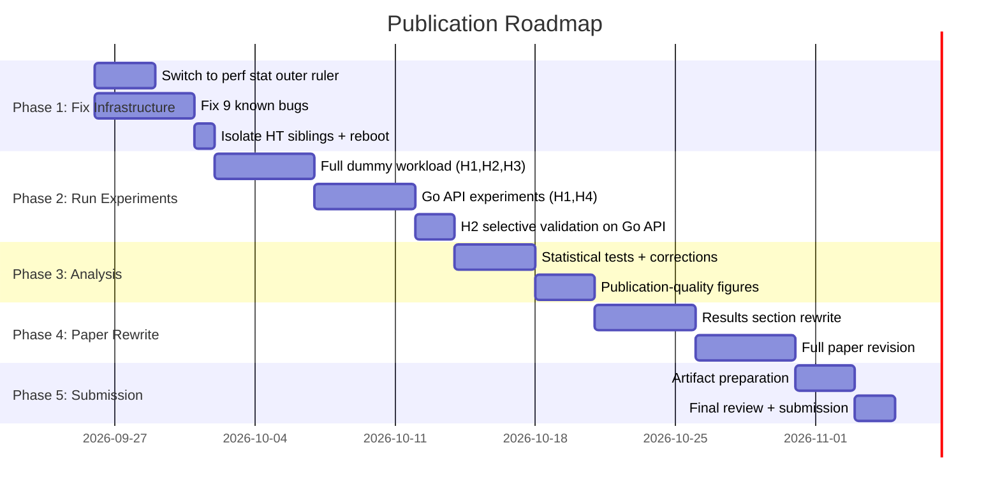

# Publication Roadmap: Meta-Profiling Paper

## Honest Assessment: Where You Stand Today

### What You Have (Strengths)
Your project has a **genuinely publishable core idea**: a three-layer, NUMA-aware isolation architecture for measuring profiler overhead with statistical rigor. This is a real contribution — no prior work satisfies all three of: measurer isolation, mechanism decomposition, and formal equivalence testing. The positioning table (Table I in the paper) makes this clear.

**Concrete assets:**
- ✅ Well-designed 3-layer isolation architecture with NUMA-aware CPU pinning
- ✅ Solid hypothesis framework (H1–H4) with proper statistical tests (TOST, Welch's ANOVA, ablation)
- ✅ Documented NUMA topology analysis with principled CPU selection rationale
- ✅ Pilot data (50 iterations) for H1, H2, H3, H4 on dummy workload
- ✅ Automation scripts (Python + Makefiles) for reproducible experiments
- ✅ A Go microservice + Docker stack for production-representative workload
- ✅ Good related work positioning against GWP, Scaler, Tintin, Uno-kprobe, bperf

### What's Broken (Critical Gaps)

> [!CAUTION]
> **The paper currently reports results from a pilot study of only 50 iterations on a single synthetic workload.** This is the single biggest blocker. No conference will accept this.

| Gap | Severity | Impact on Publication |
|-----|----------|----------------------|
| **Only pilot data (N=50), single workload** | 🔴 Fatal | H1 (workload independence) is completely untested — no cross-workload data exists |
| **Go API H4 data collected but never analyzed** ([analyze_hypotheses.py](file:///home/rishi/Desktop/Meta-Profiling/meta_profiling_deliverables/common/analyze_hypotheses.py)) | 🔴 Fatal | The "production negligibility" claim has zero production data behind it |
| **eBPF measurement tool has known critical bugs** ([analysis_results.md](file:///home/rishi/Desktop/Meta-Profiling/analysis_results.md)) | 🔴 Fatal | PMU contention, PID drift, observer effect inflation — data may be corrupted |
| **Using bpftrace as outer ruler (quantization noise)** | 🟠 High | `perf stat` should be the primary outer ruler; bpftrace has 10K-cycle quantization |
| **No `perf stat` as primary measurement tool** | 🟠 High | Paper describes `perf stat` as "exact counting" but experiments use bpftrace |
| **HyperThread siblings not isolated** | 🟡 Medium | Acknowledged in [numa_topology_analysis.md](file:///home/rishi/Desktop/Meta-Profiling/numa_topology_analysis.md) but not fixed |
| **No reproducibility package** | 🟡 Medium | Reviewers increasingly expect artifact evaluation |

### Paper Draft Quality Assessment

The paper draft ([CCBD.pdf](file:///home/rishi/Desktop/Meta-Profiling/CCBD.pdf)) reads well structurally — the intro, related work, and methodology sections are at publication quality. However:

| Section | Quality | Issue |
|---------|---------|-------|
| Abstract | ⭐⭐⭐ | Claims "pilot study using a dummy workload" — honest but weak |
| Introduction | ⭐⭐⭐⭐ | Strong motivation, clear gap identification |
| Related Work | ⭐⭐⭐⭐ | Good positioning table, sufficient references |
| Methodology | ⭐⭐⭐⭐ | Well-described architecture, but missing `perf stat` details |
| Results | ⭐⭐ | **Only pilot data, single workload, no Go API results** |
| Threats to Validity | ⭐⭐⭐ | Honest about limitations, but too many "future work" items |
| Conclusion | ⭐⭐ | 3 of 4 hypotheses are "partially supported" or "future work" |

---

## Target Venues

Based on the paper's scope (systems measurement methodology, profiling overhead), here are realistic targets ordered by fit:

| Venue | Deadline (Typical) | Fit | Why |
|-------|-------|-----|-----|
| **ICPE** (ACM/SPEC Int'l Conf. Performance Engineering) | ~Nov/Dec | ⭐⭐⭐⭐⭐ | Perfect match — measurement methodology, profiling overhead |
| **ISPASS** (IEEE Int'l Symp. Performance Analysis of Systems & Software) | ~Dec/Jan | ⭐⭐⭐⭐⭐ | Directly targets performance analysis methodology |
| **MASCOTS** (IEEE Int'l Symp. Modeling, Analysis, Simulation of Computer Systems) | ~Apr/May | ⭐⭐⭐⭐ | Good fit for measurement methodology |
| **IISWC** (IEEE Int'l Symp. Workload Characterization) | ~Jun/Jul | ⭐⭐⭐⭐ | Workload characterization angle works |
| **CHEOPS** (Workshop on Challenges in Performance Methods for Software Dev.) | Varies | ⭐⭐⭐⭐ | Workshop — lower bar, you already cite their 2026 paper |
| **IC2E** (IEEE Int'l Conf. Cloud Engineering) | ~Feb/Mar | ⭐⭐⭐ | Cloud observability angle |
| **SoCC** / **Middleware** Posters/WiP tracks | Varies | ⭐⭐⭐ | Work-in-progress tracks are more forgiving |

> [!TIP]
> **Most realistic first target: ICPE 2027 or ISPASS 2027.** These are the natural homes for this work. Alternatively, a workshop paper at CHEOPS requires less data but still counts as a publication.

---

## Phase 1: Fix Critical Experimental Infrastructure (Weeks 1–2)

> [!IMPORTANT]
> Nothing else matters until the measurement pipeline produces trustworthy data. The current eBPF-based measurement has multiple known bugs that invalidate the collected data.

### 1.1 Switch Primary Outer Ruler to `perf stat`

The paper already describes `perf stat` as "exact counting" — but the actual experiments use bpftrace with overflow sampling. This must be fixed.

**Why:** `perf stat` reads hardware PMU registers directly with zero quantization error. bpftrace's overflow-based counting has 10K-cycle quantization noise and observer effects (Issues 3-4 in [analysis_results.md](file:///home/rishi/Desktop/Meta-Profiling/analysis_results.md)).

**What to do:**
```bash
# The outer ruler should be:
taskset -c 14 perf stat -e cycles,cache-misses,branch-misses,context-switches \
    -p <perf_record_PID> -- sleep <DURATION>
```

- Modify [run_hypotheses_dummy.py](file:///home/rishi/Desktop/Meta-Profiling/meta_profiling_deliverables/dummy_workload_test/run_hypotheses_dummy.py) to use `perf stat` as the primary measurement
- Keep bpftrace as a **diagnostic** tool only (for per-function latency attribution), not as the counting tool
- Ensure `perf stat` uses ≤ 4 general-purpose events to avoid PMU multiplexing

### 1.2 Fix the 9 Known Bugs

From [analysis_results.md](file:///home/rishi/Desktop/Meta-Profiling/analysis_results.md), fix in priority order:

| # | Bug | Fix |
|---|-----|-----|
| 1 | Workload PID changes mid-measurement | Use CPU-based filtering (`-C 6`) instead of PID filtering for bpftrace |
| 2 | PMU counter contention on CPU 6 | Eliminate: use `perf stat` on CPU 14 (no PMU conflict) |
| 3 | bpftrace NMI inflates perf record measurement | Eliminate: move to `perf stat` as primary ruler |
| 4 | Quantization noise | Eliminate: `perf stat` has exact counts |
| 5 | **Go API H4 data never analyzed** | Fix [analyze_hypotheses.py](file:///home/rishi/Desktop/Meta-Profiling/meta_profiling_deliverables/common/analyze_hypotheses.py) `analyze_h4()` to actually use `goapi_df` with `hypothesis="H4"` |
| 6 | H4 ratio paired by index, not iteration | Join on `iteration` column before computing ratios |
| 7 | Inconsistent sampling periods across `.bt` scripts | Standardize or eliminate by using `perf stat` |
| 8 | `BPFTRACE_CPU` never used | Remove misleading variable or actually pin with `taskset` |
| 9 | `measure_constant_work` timing gap | Wait for bpftrace `Attaching N probes...` stderr instead of `sleep(5)` |

### 1.3 Isolate HyperThread Siblings

```bash
# Update GRUB:
# Old:  isolcpus=6,7,14,15
# New:  isolcpus=6,7,14,15,22,23,30,31
sudo sed -i 's/isolcpus=6,7,14,15/isolcpus=6,7,14,15,22,23,30,31/' /etc/default/grub
sudo update-grub && sudo reboot
```

### 1.4 Add L1 Cache Events

Per mentor feedback (Q4 in [mentor_feedback_analysis.md](file:///home/rishi/Desktop/Meta-Profiling/mentor_feedback_analysis.md)):
```bash
perf stat -e cycles,L1-dcache-load-misses,LLC-load-misses,branch-misses,context-switches ...
```

This distinguishes L1 vs L3 cache effects — critical for the cache-pollution narrative.

**Deliverable:** A clean, bug-free measurement pipeline using `perf stat` as the primary outer ruler.

---

## Phase 2: Run Full Experiments (Weeks 2–4)

### 2.1 Full Dummy Workload Experiments (H1, H2, H3)

Run with proper sample sizes based on pilot power analysis:

| Experiment | Config | Iterations | Est. Time |
|-----------|--------|-----------|-----------|
| H1 baseline + profiled | `-g -c 100K` | 500 paired | ~2 hours |
| H2 frequency sweep | 6 `-c` values × randomized blocks | 200 per config | ~5 hours |
| H3 `-g` ablation | `-g` on/off paired | 500 paired | ~2 hours |

**Critical:** Use randomized block design (not sequential) for H2. Your [hypothesis_framework.md](file:///home/rishi/Desktop/Meta-Profiling/hypothesis_framework.md) already describes this — implement it.

### 2.2 Go API Experiments (H1 cross-workload + H4 production negligibility)

This is the **most important missing piece**. Without this data, H1 and H4 cannot be claimed.

| Experiment | What | Iterations | Est. Time |
|-----------|------|-----------|-----------|
| H1 Go API | `perf record -g -c 100K` on Go API, measured by `perf stat` on CPU 14 | 500 | ~4 hours |
| H4 Go API (constant work) | Baseline vs profiled, 1000 requests per iteration | 500 paired | ~8 hours |
| H2 selective validation | `-c 10K`, `-c 100K`, `-c 1M` on Go API | 200 per config | ~4 hours |

**Constant-work protocol for H4:**
1. Warm-up: 500 requests
2. Start `perf stat` on Go API PID
3. Send exactly 1000 requests via `hey -n 1000 -c 10`
4. Stop `perf stat` → record baseline values
5. Cool-down (2s)
6. Repeat with `perf record` running → record profiled values

### 2.3 Record System State

Every experiment session must save:
- `lscpu`, `uname -a`, `/proc/cmdline`, `numactl --hardware`
- Turbo Boost status, ASLR status, THP status
- Git commit hash
- Kernel version

**Deliverable:** Complete CSV datasets for all 4 hypotheses across both workloads.

---

## Phase 3: Statistical Analysis & Visualization (Week 4–5)

### 3.1 Run All Planned Statistical Tests

| Hypothesis | Test | What You Need |
|-----------|------|--------------|
| H1 | Welch's ANOVA across workloads | Dummy + Go API cycle counts |
| H1 | TOST pairwise equivalence (Δ = 10%) | Prove costs are equivalent |
| H2 | OLS regression + F-test for non-linearity | 6 sampling frequencies |
| H2 | Piecewise-linear or log model comparison | AIC/BIC comparison |
| H3 | Paired t-test (or Wilcoxon) | With-g vs without-g paired data |
| H3 | Cohen's d effect size | Quantify practical significance |
| H4 | TOST equivalence (Δ = 1%) on Go API | Baseline vs profiled Go API |
| All | Holm-Bonferroni correction across ~23 tests | Adjusted p-values |

### 3.2 Create Publication-Quality Figures

You need at minimum these figures:

1. **Architecture diagram** — The 3-layer NUMA isolation figure from [numa_topology_analysis.md](file:///home/rishi/Desktop/Meta-Profiling/numa_topology_analysis.md) (clean up for publication)
2. **H2 scaling curve** — X-axis: sampling frequency (1/c), Y-axis: overhead (cycles). Show data points + regression line + confidence bands. Mark the "knee" region.
3. **H3 ablation bar chart** — Stacked bars: base sampling cost vs call-graph cost for each metric
4. **H4 equivalence plot** — Show 90% CI relative to ±1% equivalence bounds for each metric
5. **H1 cross-workload comparison** — Bar chart with error bars comparing absolute overhead across dummy and Go API

### 3.3 Per-Request Overhead Claim

After H4 data, compute:
```
total_overhead = mean(profiled_cycles) - mean(baseline_cycles)
per_request = total_overhead / 1000
```
→ *"For every 100 requests, perf record consumed X additional CPU cycles"*

**Deliverable:** Complete statistical analysis with all p-values, effect sizes, confidence intervals, and publication-quality figures.

---

## Phase 4: Paper Rewrite (Weeks 5–7)

### 4.1 Structural Changes

The current draft needs these structural changes:

| Section | Current State | What to Change |
|---------|--------------|----------------|
| Abstract | Says "pilot study" | Remove "pilot" — present full results |
| Results (V) | Only dummy workload pilot | Add Go API results for H1, H4. Replace N=50 with full N. |
| H1 Results | "Partially supported" (no cross-workload) | **Present Welch's ANOVA across both workloads** |
| H4 Results | Dummy workload TOST | **Present Go API TOST — the actual production claim** |
| Conclusion | 3 "future work" items | Reduce to 1 genuine extension (eBPF tracer generalization) |
| Threats to Validity | Too many disclaimers | Tighten — you'll have addressed most of them |

### 4.2 Key Narrative Changes

**Current narrative (weak):**
> "We ran a pilot of 50 iterations on a dummy workload. Most things are partially supported. Cross-workload validation is future work."

**Target narrative (strong):**
> "We validated the Meta-Profiling framework across two distinct workloads (synthetic + production Go microservice) with 500+ iterations each. H1: profiler cost is workload-independent (ANOVA p > 0.05, TOST equivalence within ±10%). H2: non-linear scaling reveals a practical knee at -c 100K. H3: call-graph recording is the dominant cost (50.4% of total). H4: overhead is confirmed negligible (<1%) for production Go microservices using formal equivalence testing on constant-work measurements."

### 4.3 Strengthen the "Contribution" Claim

Your paper's contribution is the **measurement methodology**, not a faster tool. Make this crystal clear:

1. Three-layer NUMA-aware isolation architecture (eliminates observer effect)
2. Falsifiable four-hypothesis evaluation framework (not just "overhead is small")
3. First formal equivalence testing (TOST) of continuous profiling overhead
4. Identification of the non-linear sampling-frequency knee and symbol-resolution bottleneck

### 4.4 Address Reviewer Concerns Preemptively

Likely reviewer objections and how to preempt them:

| Objection | Preemptive Defense |
|-----------|-------------------|
| "Only one profiler (perf record)" | Acknowledge as scope limitation; methodology is generalizable to eBPF/ftrace |
| "Only one hardware platform" | Acknowledge; present methodology as transferable, not absolute numbers |
| "Why not just use wall-clock time?" | Explain why PMU-level attribution is needed for sub-1% effects |
| "Why TOST and not just t-test?" | Section already explains this well — keep it |
| "N=500 may not be enough for cache-miss TOST" | Report power analysis; suggest metric-specific margins |

---

## Phase 5: Submission Preparation (Weeks 7–8)

### 5.1 Artifact Preparation

Most systems conferences now have artifact evaluation. Prepare:

- [ ] Docker image or VM with all dependencies
- [ ] Single `make reproduce` command that runs all experiments
- [ ] CSV output → analysis script → figures pipeline
- [ ] README with hardware requirements

### 5.2 Final Checklist

- [ ] All 4 hypotheses have full data (not pilot) from both workloads
- [ ] All statistical tests use Holm-Bonferroni correction
- [ ] All figures are vector graphics (PDF/SVG), not raster
- [ ] References are complete (no "[Author et al.]" placeholders)
- [ ] Page count within venue limit (typically 10–12 pages for ICPE/ISPASS)
- [ ] Abstract contains concrete numbers, not vague claims
- [ ] HyperThread siblings are isolated in final experiments
- [ ] `perf stat` is the primary measurement tool (not bpftrace)
- [ ] Go API H4 data is analyzed (Bug #5 fixed)

---

## Timeline Summary



> **Total estimated time: 6–8 weeks of focused work.**

---

## Critical Decision Points

> [!IMPORTANT]
> These decisions need to be made with your mentor before proceeding:

1. **Workshop vs Full Conference?**
   - Workshop (CHEOPS): Can submit with dummy workload + Go API pilot data (~4 pages). Faster but less prestigious.
   - Full conference (ICPE/ISPASS): Needs complete H1–H4 with both workloads. More work but stronger publication.

2. **Keep bpftrace data or re-collect everything?**
   - The pilot data has known measurement issues (PMU contention, quantization).
   - Recommended: **Re-collect everything** with `perf stat` as outer ruler. The pilot data becomes "preliminary motivation" only.

3. **Scope of H1 workloads?**
   - Minimum: dummy + Go API (2 workloads)
   - Ideal: dummy + Go API + I/O-bound (fio) (3 workloads)
   - More workloads = stronger H1 claim but more experiment time

4. **eBPF tracer comparison (future work or include)?**
   - The paper lists "tracer generalization" as future work
   - Including even a small eBPF kprobe comparison would significantly strengthen the paper
   - Recommended: Keep as future work for the first submission; add for camera-ready if accepted

---

## What Makes This Publishable

The core insight — that **nobody has rigorously measured profiler overhead with proper isolation and equivalence testing** — is genuinely novel. The reviewer mental model will be:

> "I already know profiling overhead is small. Why should I care about this paper?"

Your answer must be: **"You believe it's small. We prove it's small. The difference matters."** Back this with:

1. The observation that existing overhead studies conflate cost sources, lack statistical rigor, and ignore observer effects (your Table I)
2. The non-linear frequency-scaling knee (not predicted by Gregg's linear model — a genuine new finding)
3. The symbol-resolution bottleneck attribution (actionable optimization target)
4. Formal equivalence testing that turns a "rule of thumb" into a "falsifiable claim"

If you execute this roadmap, you have a strong ICPE or ISPASS paper.
